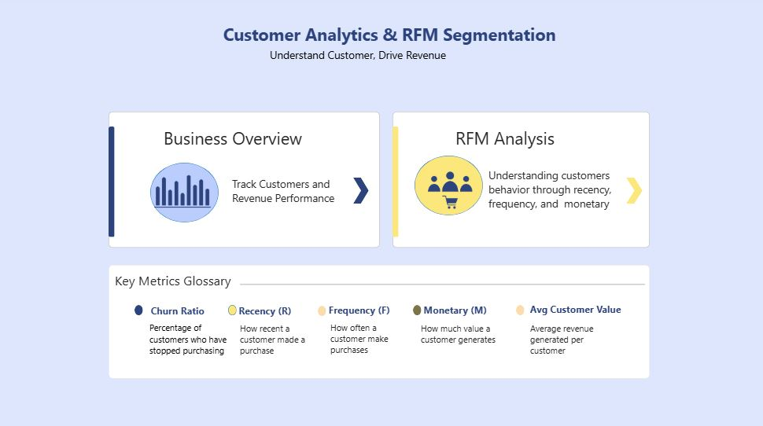
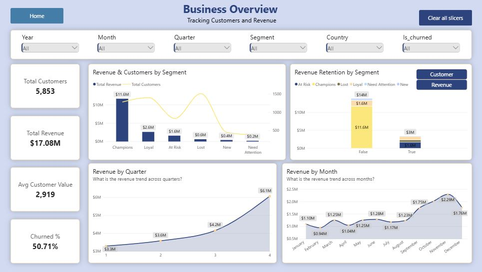

# Customer-Analytics---RFM-Segmentation

The project analyzes customer purchasing behavior using transaction data from an unnamed UK-based online retailer specializing in occasional giftware products. Using RFM (Recency, Frequency, and Monetary) analysis, I segmented customers based on their purchasing behavior to identify high-value and at-risk customer segments, evaluate customer retention and revenue contribution, and explore changes in customer behavior across different periods and countries.

## Recency Cutoff
To identify inactive customers, I set a 90-day threshold based on their recency. Customers who had not made a purchase within the last 90 days were classified as churned for this analysis.

## Business Problem

The business generates millions in revenue but lacks a clear understanding of its customer base, including which customer segments contribute the most revenue, which customers have stopped purchasing, and where opportunities exist to improve customer value and retention.

Key Questions I Answered

•	Which customer segments contribute the most revenue, and what percentage of total revenue does each segment generate?

•	What percentage of customers were classified as churned under the 90-day threshold, and how much historical revenue did they contribute?

•	Are there any countries generating substantially higher revenue despite having a relatively small customer base?

•	How do revenue, customer count, and churn rate change across years, quarters, and months?

•	Based on RFM segments, which customer groups should receive more attention for retention, re-engagement, and promotional activities?

## Key Findings

•	Revenue Concentration: Champions represented approximately 21% of distinct customers but contributed nearly 70% of total revenue ($11.6 million).

•	Customer Churn: Approximately 50.71% of distinct customers were classified as churned under the 90-day threshold. These customers collectively generated approximately 20% of total historical revenue ($3.31 million).

•	Country-wise Performance: EIRE and the Netherlands had fewer than 25 customers each but generated revenue exceeding $550,000, indicating higher average revenue per customer compared with other countries.

•	Time-based Trends: Revenue and customer numbers generally increased, with noticeable growth between August and November. 

## Recommendations

1. Customer Retention & Re-engagement: Approximately 97% of historical revenue from churned customers came from the Loyal, At Risk, and Lost segments, with the At-Risk segment alone contributing nearly 50%. The business should prioritize investigating these segments and consider targeted retention or re-engagement activities based on their purchasing history and customer value.

2. Explore Country-wise Growth Opportunities: EIRE and the Netherlands showed higher average revenue per customer despite having relatively few customers. The business could further investigate these markets and explore targeted promotional activities to attract new customers and evaluate their growth potential.

## Data Source

Online Retail II dataset, publicly available on Kaggle.
The dataset contains 1,067,371 transaction records from a UK-based online retailer, covering the period from December 2009 to December 2011. It includes invoice, product, quantity, pricing, transaction date, and customer information.

## Tech Stack

Python: Used for data exploring, cleaning, and implementing RFM-based customer segmentation logic. 

Visual Studio Code: Used as the development environment for writing, running, and debugging Python scripts.

Power BI Desktop: Used to develop a three-page interactive report, including a navigation page.

## Key Terms Used

•	Recency: How recently a customer made their last purchase relative to the last transaction date in the dataset.

•	Frequency: How often a customer makes purchases during the given period.

•	Monetary: The total amount a customer has spent over the given period.

•	Churned Customers: Customers who have not made any purchase within last 90 days.

•	Average Customer Value: The average revenue generated per customer during the given period.

## Project Workflow

1. Understanding the Business – Went through the brief description provided with the dataset and identified the business questions that the analysis would address.

2. Data Preparation & Customer Segmentation – Loaded the raw dataset into Visual Studio Code using Pandas, explored the data, and calculated RFM scores to segment customers based on their purchasing behavior. Removed 34,335 duplicate rows and cleaned records with negative quantities, missing customer IDs, and transactions where no purchases were made. Also created a calendar table to maintain consistent date dimensions for time-based analysis. Finally, exported three separate CSV files: Customers, Transactions, and Calendar, avoiding the repetition of customer-level RFM scores across transaction records.

3. Power BI & Dashboard Design – Connected the cleaned CSV files to Power BI, created the required DAX measures, and developed a three-page interactive report, including a navigation page to move between the dashboards.

## Dashboard Structure

Home Page: The project headline, buttons to navigate to the two dashboard pages, and a short explanation of the terms used.

Business Overview: This page opens with four KPIs: distinct customers, total revenue, average customer value and churn ratio at left. At right, it compares revenue and customer count across segments, and shows how many customers and how much revenue come from churned vs active customers in each segment. Quarterly and monthly charts show how customers and revenue performed over time. Slicers for customer segment, churned status and time (year, quarter, month) filter every visual on the page.

RFM Analysis: This page starts with an RFM summary view. Next to it, a button switches between average customer value by top 5 countries and by customer segment. Churn ratio is shown by year, quarter and month. Slicers for customer segment, churned status and time (year, quarter, month) filter every visual on the page.

## Data Limitations

The dataset includes a mix of customers, including wholesalers purchasing products in bulk for resale and customers buying for personal use. Since these customer types may exhibit different purchasing patterns, analyzing them together may influence RFM scores and segment profiles. As the dataset does not explicitly distinguish between these customer types, the observed customer segments may reflect a combination of wholesale and individual purchasing behavior.

## Sample Python Scripts

rfm['R_Score'] = pd.qcut(rfm['recency'],5,labels= [5,4,3,2,1]).astype(int)

rfm['F_Score'] = pd.qcut(rfm['frequency'].rank(method= 'first'),5,labels= [1,2,3,4,5]).astype(int)

rfm['M_Score'] = pd.qcut(rfm['monetary'],5,labels= [1,2,3,4,5]).astype(int)

## Live Report

[Live Report](https://app.powerbi.com/reportEmbed?reportId=5c65c58d-100e-47f7-b85b-9cd14ce204c1&autoAuth=true&ctid=56c1d497-700b-49cf-8f8d-3dd6b20d522f)

